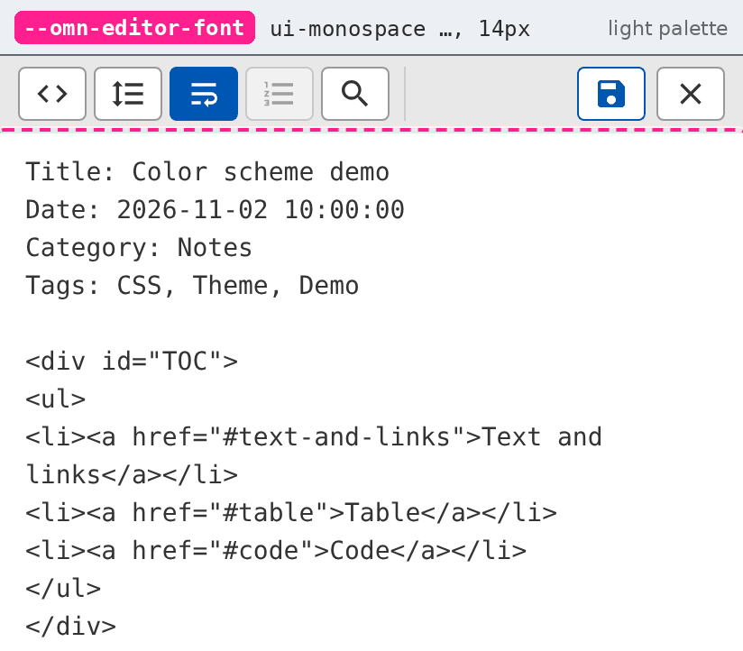
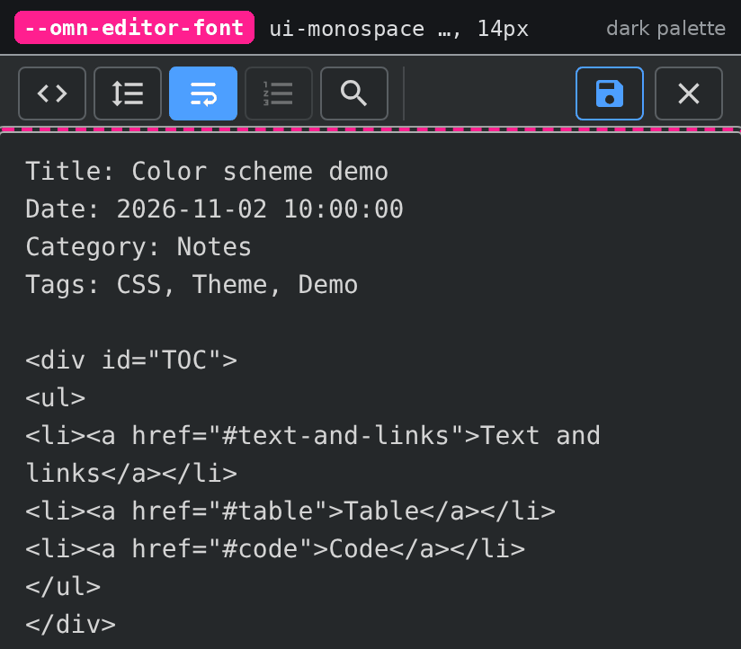

# Color scheme tokens

This document shows the CSS custom properties (the tokens) that a color scheme sets. For each token, it shows the part of an OMN-Go page that the token colors.

## How a scheme works

Section 1 of `backend/frontend/html/css/OMN-Go/omn-go-core.css` defines the tokens. Each token has a light value in `:root` and a dark value in `:root[data-theme="dark"]`. The media query `prefers-color-scheme: dark` holds a second copy of the dark values for the theme "auto".

A scheme is one marked block in `css/omn-go-custom.css`. Each page loads this file last, thus the values of the block win over the values of `omn-go-core.css`. The block sets the light palette, the dark palette and three fonts.

The editor page does not load `css/omn-go-custom.css`. Thus a scheme does not change the editor. The editor keeps the values of `omn-go-core.css`. This document names the editor parts that use a token, but a scheme does not change them.

## The pictures

- Each picture is a part of a real OMN-Go page on a phone screen, 412 CSS pixels wide.
- Each picture shows the default palette of OMN-Go, with no scheme. Each token has one picture for the light palette and one for the dark palette.
- A pink dashed frame marks the part that the token colors.
- The strip above the picture gives the token, its default value with a sample of the color, and the palette.
- A test set each token to a different color and compared the page before and after. For each color token, the framed part changed. For `--bg`, the frame marks the content area, and the page body behind it changed.

A token that ends in `-hover` colors a control under a mouse pointer. Its picture shows that state.

## Summary

| Group | Token | Light | Dark |
| --- | --- | --- | --- |
| Surfaces | [`--bg`](#--bg) | `#f9f9f9` | `#1b1d1e` |
| Surfaces | [`--bg-surface`](#--bg-surface) | `#ffffff` | `#25282a` |
| Surfaces | [`--bg-band`](#--bg-band) | `#e8e8e8` | `#2a2d2f` |
| Surfaces | [`--bg-inset`](#--bg-inset) | `#f5f5f5` | `#303336` |
| Surfaces | [`--bg-hover`](#--bg-hover) | `#d0d0d0` | `#3a3e41` |
| Surfaces | [`--bg-metadata`](#--bg-metadata) | `#e9ecef` | `#2e3235` |
| Surfaces | [`--bg-toc`](#--bg-toc) | `#fafafa` | `#232628` |
| Text | [`--text`](#--text) | `#333333` | `#d4d4d4` |
| Text | [`--text-strong`](#--text-strong) | `#1a1a1a` | `#e8eaed` |
| Text | [`--text-heading`](#--text-heading) | `#444444` | `#c4c7cb` |
| Text | [`--text-muted`](#--text-muted) | `#555555` | `#9aa0a6` |
| Text | [`--text-faint`](#--text-faint) | `#666666` | `#8a9096` |
| Borders | [`--border`](#--border) | `#cccccc` | `#45494d` |
| Borders | [`--border-soft`](#--border-soft) | `#dddddd` | `#3a3e41` |
| Borders | [`--border-card`](#--border-card) | `#e1e4e8` | `#3a3e41` |
| Borders | [`--border-strong`](#--border-strong) | `#999999` | `#5a5f63` |
| Accent and state | [`--accent`](#--accent) | `#0056b3` | `#4d9fff` |
| Accent and state | [`--accent-hover`](#--accent-hover) | `#004494` | `#6cb0ff` |
| Accent and state | [`--success`](#--success) | `#28a745` | `#28a745` |
| Accent and state | [`--success-hover`](#--success-hover) | `#218838` | `#218838` |
| Accent and state | [`--danger`](#--danger) | `#dc3545` | `#dc3545` |
| Accent and state | [`--info`](#--info) | `#17a2b8` | `#17a2b8` |
| Accent and state | [`--secondary`](#--secondary) | `#6c757d` | `#6c757d` |
| Tags | [`--tag-bg`](#--tag-bg) | `#e7e7e7` | `#3a3d40` |
| Tags | [`--tag-border`](#--tag-border) | `#505050` | `#808080` |
| Tags | [`--tag-selected`](#--tag-selected) | `#888888` | `#5a5f63` |
| Search hits | [`--search-hit-bg`](#--search-hit-bg) | `#ffe08a` | `#7a5c14` |
| Search hits | [`--search-hit-text`](#--search-hit-text) | `#1a1a1a` | `#ffeab0` |
| Tables | [`--table-border`](#--table-border) | `#4d6bfe` | `#4d6bfe` |
| Tables | [`--table-th-bg`](#--table-th-bg) | `#cccccc` | `#3a3d40` |
| Tables | [`--table-th-text`](#--table-th-text) | `#000000` | `#e8eaed` |
| Tables | [`--table-row-odd`](#--table-row-odd) | `#eeeeee` | `#2a2d2f` |
| Tables | [`--table-row-even`](#--table-row-even) | `#ffffff` | `#25282a` |
| Tables | [`--table-text`](#--table-text) | `#000000` | `#d4d4d4` |
| Code blocks (hljs) | [`--code-bg`](#--code-bg) | `#f3f3f3` | `#303336` |
| Code blocks (hljs) | [`--code-text`](#--code-text) | `#444444` | `#c9d1d9` |
| Code blocks (hljs) | [`--code-comment`](#--code-comment) | `#697070` | `#8b949e` |
| Code blocks (hljs) | [`--code-punctuation`](#--code-punctuation) | `#444444aa` | `#c9d1d966` |
| Code blocks (hljs) | [`--code-string`](#--code-string) | `#880000` | `#a5d6ff` |
| Code blocks (hljs) | [`--code-variable`](#--code-variable) | `#ab5656` | `#ffa657` |
| Code blocks (hljs) | [`--code-literal`](#--code-literal) | `#669955` | `#79c0ff` |
| Code blocks (hljs) | [`--code-built-in`](#--code-built-in) | `#397300` | `#7ee787` |
| Code blocks (hljs) | [`--code-meta`](#--code-meta) | `#1f7199` | `#79c0ff` |
| Code blocks (hljs) | [`--code-meta-string`](#--code-meta-string) | `#3388aa` | `#a5d6ff` |
| Code blocks (hljs) | [`--code-tag-name`](#--code-tag-name) | `#444444` | `#444444` |
| Code blocks (hljs) | [`--code-tag-attr`](#--code-tag-attr) | `#444444` | `#444444` |

## Surfaces

### --bg

The background of the page.

| Light palette | Dark palette |
| --- | --- |
|  |  |

### --bg-surface

The background of a panel, a dialog, a card and an input field. The picture shows the Quick Note panel. The search dialog, the Config card and the editor tool buttons also use it.

| Light palette | Dark palette |
| --- | --- |
|  |  |

### --bg-band

The background of the page header and of the page footer. In the editor, it is the background of the tool bar, the find bar, the line numbers and the status line.

| Light palette | Dark palette |
| --- | --- |
|  |  |

### --bg-inset

The background of an inset box. The picture shows the "Receive a note" box of the Incoming page. The title arrow, the Config menu items and the buttons of the Status and Log pages also use it.

| Light palette | Dark palette |
| --- | --- |
|  |  |

### --bg-hover

The background of a control under the pointer, and of the selected line of a list. The picture shows the selected result line of the search dialog. The header buttons and the tag marks use it under the pointer.

| Light palette | Dark palette |
| --- | --- |
|  |  |

### --bg-metadata

The background of the metadata panel. The info button of the page header opens this panel.

| Light palette | Dark palette |
| --- | --- |
|  |  |

### --bg-toc

The background of the table of contents box. A note makes this box with `
`.

| Light palette | Dark palette |
| --- | --- |
|  |  |

## Text

### --text

The body text of a note and the text of most controls. It also sets the color of the border of the table of contents box.

| Light palette | Dark palette |
| --- | --- |
|  |  |

### --text-strong

The page title. The titles of the search results, of the Config cards and of the dialogs also use it.

| Light palette | Dark palette |
| --- | --- |
|  |  |

### --text-heading

The labels of the Config page. The title arrow, the group titles of the Search page and the title of the "Receive a note" box also use it.

| Light palette | Dark palette |
| --- | --- |
|  |  |

### --text-muted

Hints and descriptions. The picture shows the hint of the Incoming page. The search chips that are not active and the counters of the Log page also use it.

| Light palette | Dark palette |
| --- | --- |
|  |  |

### --text-faint

Small hints. The picture shows the note name and the status line of the search dialog. The page footer, the Config hints and the status line of the editor also use it.

| Light palette | Dark palette |
| --- | --- |
|  |  |

## Borders

### --border

The border of an input field and of a plain button. The picture shows the Config page. The Quick Note panel, the metadata panel and the line below the editor tool bar also use it.

| Light palette | Dark palette |
| --- | --- |
|  |  |

### --border-soft

Thin separator lines. The picture shows the line below the input row and the line below the scope row of the search dialog. The lines between the search results and between the rows of the Files page also use it.

| Light palette | Dark palette |
| --- | --- |
|  |  |

### --border-card

The border of a large card. The picture shows the Config card. The progress card and the card of the external editor also use it.

| Light palette | Dark palette |
| --- | --- |
|  |  |

### --border-strong

The border of a button of the page header. The search dialog, the "Receive a note" box and the editor tool buttons also use it.

| Light palette | Dark palette |
| --- | --- |
|  |  |

## Accent and state

### --accent

The main accent color. The picture shows the search button and the active chip of the search dialog. The progress bar, the Config menu icons, the editor Save button and the "File:" line of the metadata panel also use it. The links in a note do not use it. They have the link color of the browser.

| Light palette | Dark palette |
| --- | --- |
|  |  |

### --accent-hover

An accent button under the pointer. The picture shows the search button of the search dialog under the pointer.

| Light palette | Dark palette |
| --- | --- |
|  |  |

### --success

The Save button and the Copy button of a panel. The Save Configuration button and the mark of a Config page with no change also use it.

| Light palette | Dark palette |
| --- | --- |
|  |  |

### --success-hover

The Save Configuration button under the pointer.

| Light palette | Dark palette |
| --- | --- |
|  |  |

### --danger

The mark of a Config page with a change that is not saved. The error texts of the Status, Log and Incoming pages also use it.

| Light palette | Dark palette |
| --- | --- |
|  |  |

### --info

The three create buttons of the page header: new note, quick note and bookmark. On Android, the button that adds the page to the home screen also uses it.

| Light palette | Dark palette |
| --- | --- |
|  |  |

### --secondary

The Refresh button and the Config button of the page header.

| Light palette | Dark palette |
| --- | --- |
|  |  |

## Tags

### --tag-bg

The background of a tag mark. The page header, the Tags page and the Search page show tag marks.

| Light palette | Dark palette |
| --- | --- |
|  |  |

### --tag-border

The border of a tag mark.

| Light palette | Dark palette |
| --- | --- |
|  |  |

### --tag-selected

The background of a tag mark with the class `tagmarkselected`. The text of that mark has the color `--bg-surface`. No OMN-Go page sets this class now. For the picture, a script added the class to the tag mark "Theme". A note script can use the class.

| Light palette | Dark palette |
| --- | --- |
|  |  |

## Search hits

### --search-hit-bg

The background of a found word. The picture shows a word that a search marks in the note. The search results and the find bar of the editor also use it.

| Light palette | Dark palette |
| --- | --- |
|  |  |

### --search-hit-text

The text of a found word in the note and in the search results.

| Light palette | Dark palette |
| --- | --- |
|  |  |

## Tables

### --table-border

The border of a table and of each cell. The value is the same in the two palettes.

| Light palette | Dark palette |
| --- | --- |
|  |  |

### --table-th-bg

The background of a header cell.

| Light palette | Dark palette |
| --- | --- |
|  |  |

### --table-th-text

The text of a header cell.

| Light palette | Dark palette |
| --- | --- |
|  |  |

### --table-row-odd

The background of the odd rows of a table.

| Light palette | Dark palette |
| --- | --- |
|  |  |

### --table-row-even

The background of the even rows of a table.

| Light palette | Dark palette |
| --- | --- |
|  |  |

### --table-text

The text of a data cell.

| Light palette | Dark palette |
| --- | --- |
|  |  |

## Code blocks (hljs)

### --code-bg

The background of a code block.

| Light palette | Dark palette |
| --- | --- |
|  |  |

### --code-text

The base text of a code block. Keywords such as `const` and `if` have this color in bold.

| Light palette | Dark palette |
| --- | --- |
|  |  |

### --code-comment

A comment.

| Light palette | Dark palette |
| --- | --- |
|  |  |

### --code-punctuation

Punctuation and the marks around an HTML tag: `<`, `=`, `>` and `</`.

| Light palette | Dark palette |
| --- | --- |
|  |  |

### --code-string

A string, a number, a type and a deleted line of a diff. A function name and a section title also use it, in bold.

| Light palette | Dark palette |
| --- | --- |
|  |  |

### --code-variable

A variable of the language, for example `document` and `console`. A link, an operator, a regular expression and a template variable also use it.

| Light palette | Dark palette |
| --- | --- |
|  |  |

### --code-literal

A literal value, for example `null` and `true`.

| Light palette | Dark palette |
| --- | --- |
|  |  |

### --code-built-in

A built-in name, a list mark and an added line of a diff. The picture shows an added line.

| Light palette | Dark palette |
| --- | --- |
|  |  |

### --code-meta

A meta item, for example `<!DOCTYPE html>` and `#include`.

| Light palette | Dark palette |
| --- | --- |
|  |  |

### --code-meta-string

A string inside a meta item, for example `"notes.h"` in `#include "notes.h"`.

| Light palette | Dark palette |
| --- | --- |
|  |  |

### --code-tag-name

The name of an HTML tag. This token is not in `omn-go-core.css`. The scheme block defines it and adds a rule that applies it to tag names. Without a scheme, the highlight theme gives tag names the fixed color `#444` in the two palettes. In the dark palette, the contrast of `#444` on `--code-bg` is 1.3:1, thus the names are almost invisible.

| Light palette | Dark palette |
| --- | --- |
|  |  |

### --code-tag-attr

The name of an HTML attribute. The rules are the same as for `--code-tag-name`.

| Light palette | Dark palette |
| --- | --- |
|  |  |

## Typography

The scheme block also sets three fonts, each with a size. The block writes the values as six variables in `:root`: `--omn-font`, `--omn-font-size`, `--omn-code-font`, `--omn-code-size`, `--omn-editor-font` and `--omn-editor-size`. `omn-go-core.css` does not read these variables. The rules of the block set the fonts directly. The variables give the values to the page that makes the scheme.

The pictures show the fonts of OMN-Go with no scheme.

### --omn-font

The main font and its size. The scheme block sets them on `body` of each page that loads the block. Without a scheme, a note uses `sans-serif` at 16 px.

| Light palette | Dark palette |
| --- | --- |
|  |  |

### --omn-code-font

The code font and its size. The scheme block sets them on `#preview pre` and `#preview code`. Without a scheme, a code block uses `monospace` at 13 px.

| Light palette | Dark palette |
| --- | --- |
|  |  |

### --omn-editor-font

The editor font and its size. The scheme block has a rule for the editor text, the mirror layer and the line numbers. The editor page does not load the block, thus this rule has no effect. The editor uses `ui-monospace, SFMono-Regular, Menlo, Consolas, monospace` at 14 px.

| Light palette | Dark palette |
| --- | --- |
|  |  |

## Tokens that a scheme does not set

`omn-go-core.css` has more tokens. A scheme block does not set them, but a rule of your own in `css/omn-go-custom.css` can set them.

| Token | Part of the page |
| --- | --- |
| `--text-dim` | The note path and the line number in the search dialog, and the counts of the Search page. |
| `--border-title` | The line below the title and below each subtitle of the Config page. |
| `--file-app`, `--file-alert`, `--file-keep`, `--file-derived`, `--file-plain` | The state words of the Files page. |
| `--start-notes-bg`, `--start-bookmarks-bg`, `--start-btn-text` | The two large buttons of the start page. The cards of the Files page also use `--start-notes-bg`. |
| `--overlay-bg`, `--shadow`, `--shadow-soft`, `--shadow-strong` | The dark layer behind a dialog, and the shadows. |
